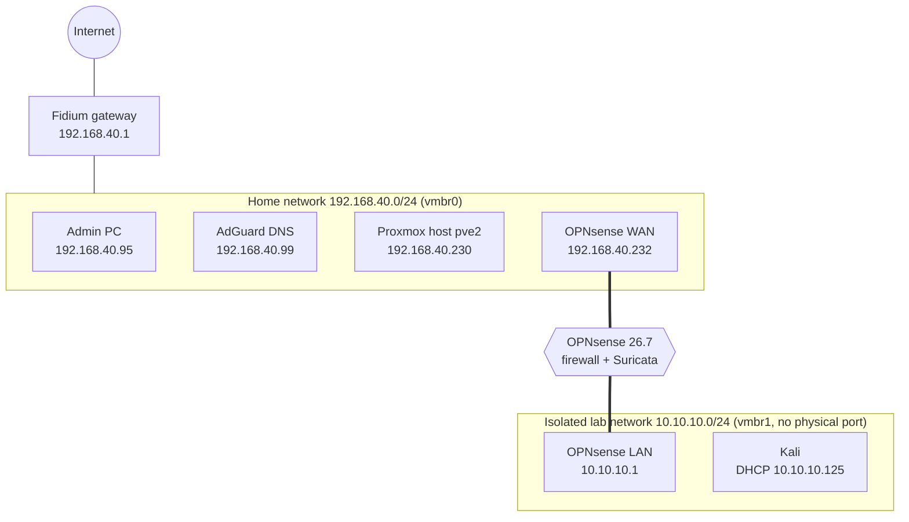
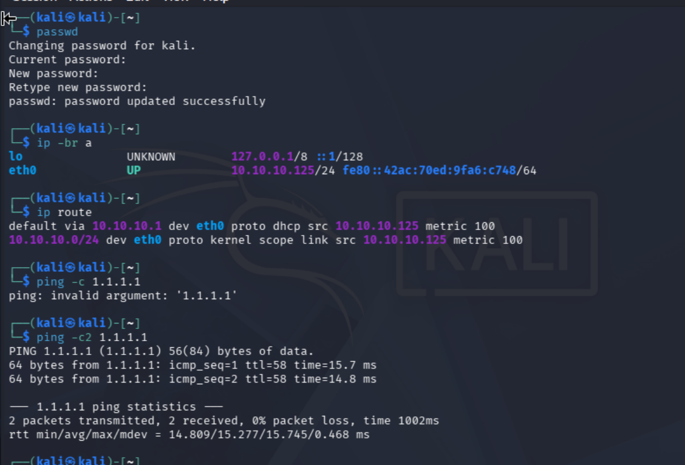
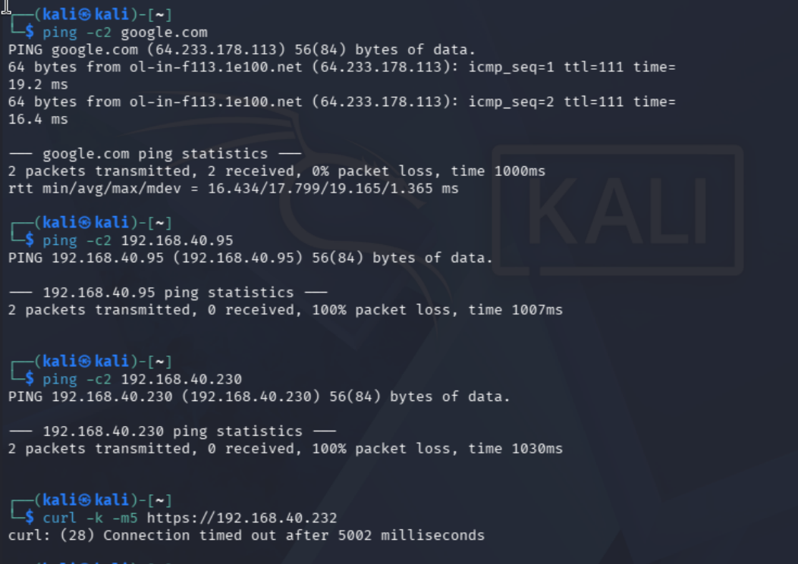
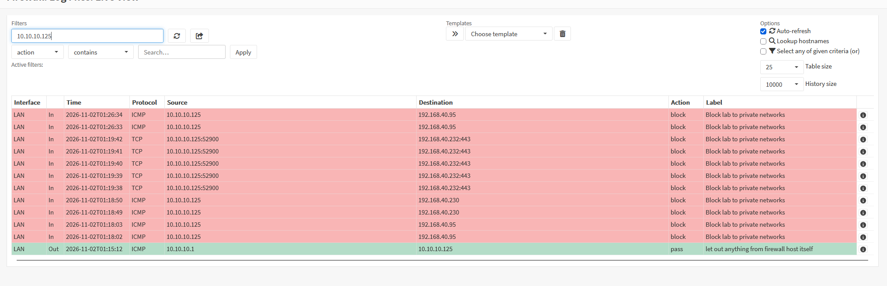
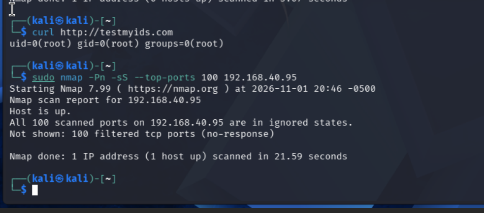
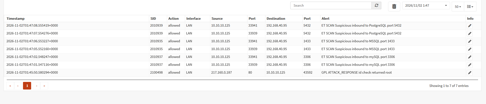

# Homelab Network Segmentation with OPNsense and Suricata

> **Result:** An isolated lab network behind an OPNsense firewall with Suricata IDS. Lab machines can reach the internet but not the home network, the hypervisor, or the firewall's management interfaces. Proven with tests from a Kali VM inside the lab: the firewall dropped every probe, and Suricata flagged the same scan.

Built to give attack tools and vulnerable machines a place to run without putting the rest of the home network at risk. The lab is treated as untrusted: anything inside it is assumed hostile.

## Network design



| Component | Details |
|---|---|
| Hypervisor | Proxmox VE 9.2 on a Lenovo ThinkCentre M920q (`pve2`) |
| Firewall | OPNsense 26.7.8_2, VM 300: 2 vCPU (`host`), 4 GB RAM, 20 GB disk (UFS) |
| WAN (`vtnet0`) | `vmbr0`, static `192.168.40.232/24`, gateway `192.168.40.1` |
| LAN (`vtnet1`) | `vmbr1`, `10.10.10.1/24`, DHCP `.100`-`.200` (`.2`-`.99` reserved for static servers) |
| Lab bridge | `vmbr1`: no physical port and no IP on the Proxmox host, so the only way in or out is through OPNsense, and the hypervisor isn't reachable from the lab |
| Test client | Kali Linux 2026.3 (official QEMU image), VM 301, single NIC on `vmbr1` |

Full build steps and the problems hit along the way: [`docs/build.md`](docs/build.md).

## Firewall policy

**Lab (LAN) rules,** evaluated top to bottom, first match wins:

| # | Action | Source | Destination | Port | Purpose |
|---|---|---|---|---|---|
| 1 | Pass | Lab network | Firewall LAN address | DNS (53) | Name resolution through the firewall |
| 2 | **Block, logged** | Lab network | `private_nets` (10.0.0.0/8, 172.16.0.0/12, 192.168.0.0/16) | any | Lab can't reach any internal network, including the firewall itself |
| 3 | Pass | Lab network | any | any | Everything else: the internet |

Rule 1 has to sit above rule 2 because the firewall's own lab address (`10.10.10.1`) is inside `10.0.0.0/8`. Blocking all of RFC 1918, not just `192.168.40.0/24`, means any future internal network is blocked from the lab by default.

**Management (WAN) rules:** HTTPS and SSH to the firewall from one host only (alias `admin_pc` = `192.168.40.95`), both logged. The web UI and SSH listen only on the WAN interface, and OPNsense's automatic anti-lockout rule is disabled, because it allowed every lab host to reach the firewall's SSH and web UI.

The rules were verified in the running firewall, not just the GUI: [`evidence/pf-lan-ruleset-final.txt`](evidence/pf-lan-ruleset-final.txt). Details and screenshots: [`docs/firewall-rules.md`](docs/firewall-rules.md).

## Proving the isolation

Tests run from Kali inside the lab:

| Test | Result | Expected |
|---|---|---|
| DHCP address | `10.10.10.125/24`, default route via `10.10.10.1` | ✓ |
| Ping `1.1.1.1` (internet) | 0% loss | ✓ allowed |
| Ping `google.com` (DNS + internet) | resolved, 0% loss | ✓ allowed |
| Ping admin PC `192.168.40.95` | 100% loss | ✓ blocked |
| Ping Proxmox host `192.168.40.230` | 100% loss | ✓ blocked |
| `curl https://192.168.40.232` (firewall web UI) | timed out after 5 s | ✓ blocked |





The firewall log shows the same attempts from the defender's side, each dropped by the logged block rule:



## Intrusion detection (Suricata)

Suricata runs on the lab interface in IDS mode (PCAP live capture: alert only, no blocking), with four ET Open rulesets from Proofpoint Emerging Threats: `emerging-scan`, `emerging-attack_response`, `emerging-exploit`, and `emerging-policy`. The full ET Open set was skipped to stay within the firewall's 4 GB of RAM.

**`HOME_NET` tuning:** Suricata's default `HOME_NET` includes all RFC 1918 ranges, which would make the lab "home." It was set to only the real home network (`192.168.40.0/24`), so the lab counts as external and untrusted. Many scan signatures are written `$EXTERNAL_NET -> $HOME_NET`; with the defaults, the scan alerts below would not have fired.

Two tests from Kali:

```
$ curl http://testmyids.com
uid=0(root) gid=0(root) groups=0(root)

$ sudo nmap -Pn -sS --top-ports 100 192.168.40.95
Host is up.
All 100 scanned ports on 192.168.40.95 are in ignored states.
Not shown: 100 filtered tcp ports (no-response)
```





| SID | Alert | Source | Destination |
|---|---|---|---|
| 2100498 | GPL ATTACK_RESPONSE id check returned root | `217.160.0.187:80` (testmyids.com) | Kali |
| 2010937 | ET SCAN Suspicious inbound to mySQL port 3306 | Kali | Admin PC |
| 2010935 | ET SCAN Suspicious inbound to MSSQL port 1433 | Kali | Admin PC |
| 2010939 | ET SCAN Suspicious inbound to PostgreSQL port 5432 | Kali | Admin PC |

**Two independent controls on the same scan:** the firewall dropped all 100 probes (nmap saw every port as `filtered`), and Suricata identified the traffic as a scan. The alerts show **Action: allowed** because Suricata is in IDS mode and only alerts; blocking was done by the firewall. One layer prevents, the other detects.

The first IDS test site tried, `testmynids.org`, had lapsed and returned a domain-parking page, so nothing could match. The original `testmyids.com` still returns the test string. SID 2100498 is written `alert ip any any -> any any`, so it fires regardless of `HOME_NET`.

**Limitation:** signature-based detection only recognizes known patterns. An attack with no published signature wouldn't alert.

## Vulnerability tracking

A package audit after updating to 26.7.8_2 found 2 packages with published vulnerabilities and no fixed version available yet from OPNsense. Raw output: [`evidence/opnsense-audit-2026-11-01.txt`](evidence/opnsense-audit-2026-11-01.txt).

| Package | CVE(s) | Exposure on this firewall | Status |
|---|---|---|---|
| `python313` 3.13.16 | CVE-2025-15367 (command injection in `poplib`) | Low: requires untrusted input passed to Python's POP3 client, which OPNsense doesn't use | Awaiting vendor package; re-audit weekly |
| `sqlite3` 3.53.4 | CVE-2026-119371 to -119379, CVE-2026-119591 | Low to moderate: requires attacker-supplied SQL or database files; SQLite is used only for OPNsense's internal data | Awaiting vendor package; re-audit weekly |

## What I learned

- **Check the running state, not the config.** Three problems in this build looked fine in the configuration and were wrong in reality: the WAN interface kept a DHCP lease (`.190`) after a static IP (`.232`) was set, an alias was saved with no content, and new rules didn't take effect until applied. `ifconfig`, `pfctl -t <alias> -T show`, and `pfctl -sr` showed the truth each time.
- **Rule order is the policy.** The new block rule was first added below the default allow-all rule, where it would never have matched. The right rule in the wrong place does nothing.
- **Automatic rules are attack surface too.** OPNsense's anti-lockout rule silently let the whole lab reach the firewall's SSH and web UI. It only showed up by reading the generated ruleset.
- **Verify which interface is which.** The installer assigned the home-network NIC as LAN. Matching MAC addresses between Proxmox and OPNsense caught it before the lab's DHCP server ended up on the home network.
- **IDS settings decide what it can see.** With Suricata's default `HOME_NET`, the lab counted as "home" and inbound-scan signatures couldn't fire. Defining the lab as external matched the threat model and made the scan visible.
- **Prove it from both sides.** The Kali tests show the attacker's view (blocked); the firewall log shows the defender's view (blocked, logged, and tied to a specific rule).
