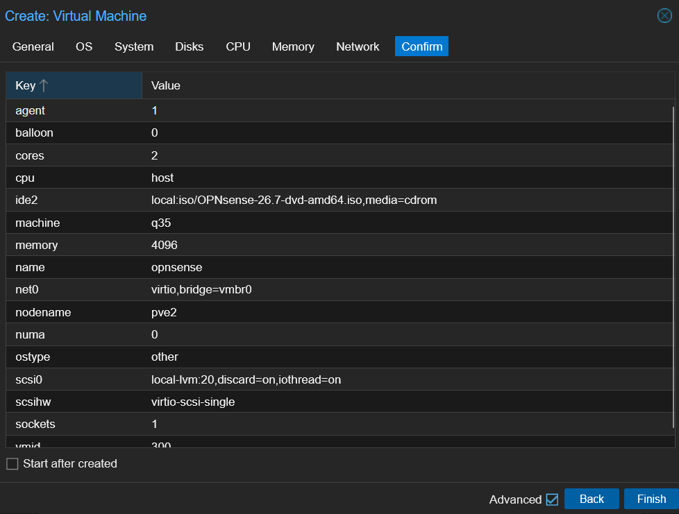
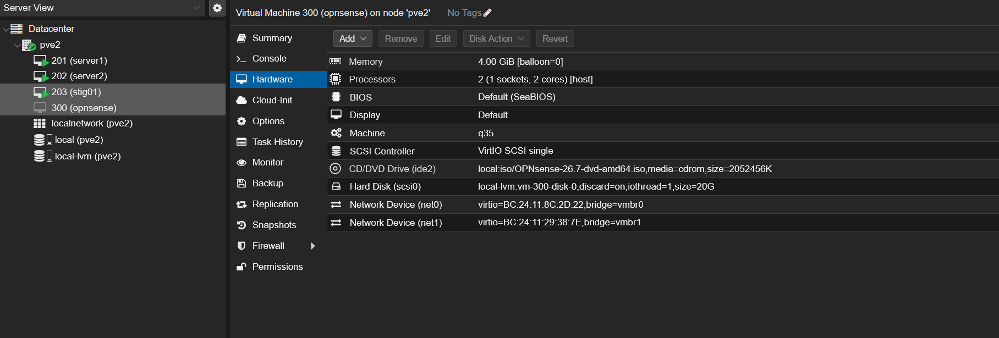
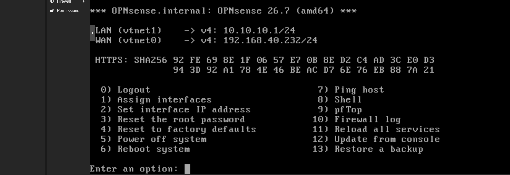
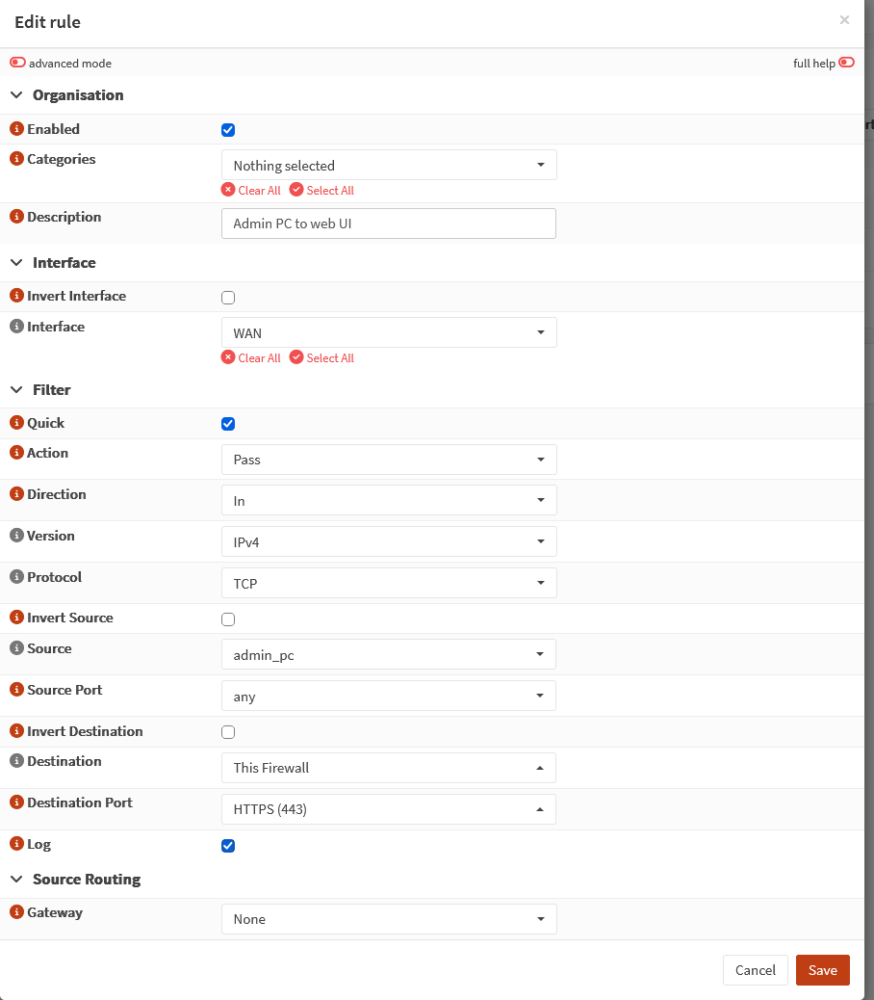
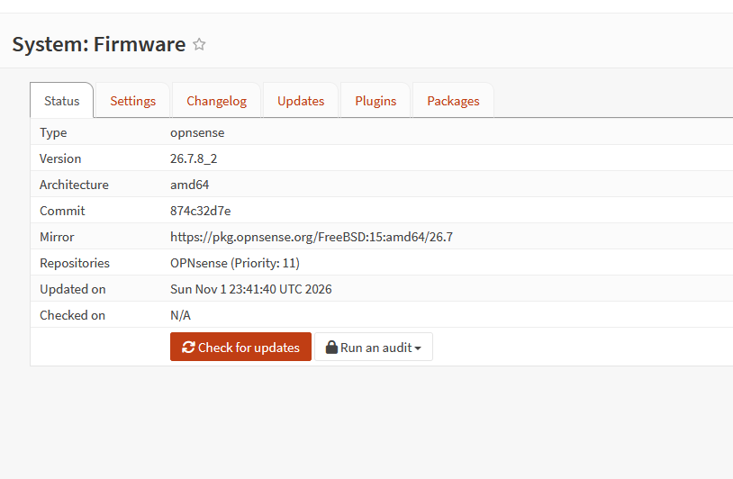
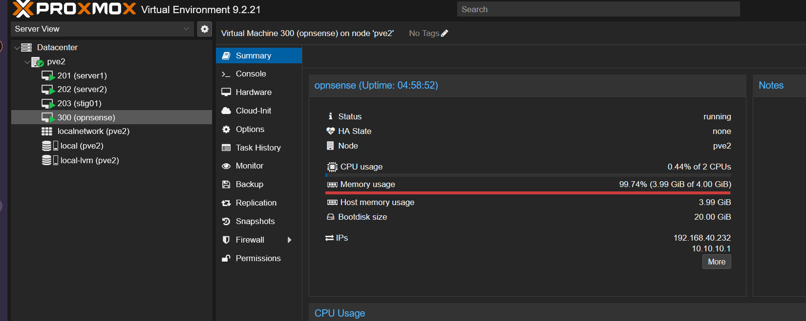

# Build and Troubleshooting Log

How the segmented network was built, in order, including what went wrong and how it was diagnosed.

## 1. Lab bridge

Proxmox: **pve2 → System → Network → Create → Linux Bridge**

| Setting | Value | Why |
|---|---|---|
| Name | `vmbr1` | |
| IPv4/CIDR | blank | The Proxmox host has no address on the lab network, so a compromised lab VM can't reach the hypervisor directly |
| Bridge ports | blank | No physical NIC: the bridge exists only inside pve2, and the firewall VM is the only path in or out |

## 2. OPNsense download and verification

```
# cd /var/lib/vz/template/iso
# wget https://mirror.wdc1.us.leaseweb.net/opnsense/releases/26.7/OPNsense-26.7-dvd-amd64.iso.bz2
# echo "95cafedda6d5b22ce832e249dc2309110fbee19f813ad78cf28bb3d387186bfb  OPNsense-26.7-dvd-amd64.iso.bz2" | sha256sum -c
OPNsense-26.7-dvd-amd64.iso.bz2: OK
# bunzip2 OPNsense-26.7-dvd-amd64.iso.bz2
```

The checksum was taken from OPNsense's official release announcement, not from the mirror. A compromised mirror could serve a tampered image along with a matching checksum file; comparing against a separate, trusted source catches that.

## 3. Firewall VM



| Setting | Value | Why |
|---|---|---|
| OS type | Other | |
| Disk | VirtIO SCSI single, 20 GB, discard, IO thread | With OS type "Other", Proxmox defaults to an emulated IDE disk. FreeBSD has VirtIO drivers built in, so the faster paravirtualized devices were selected manually. |
| CPU | 2 cores, type `host` | Passes AES-NI through for faster encryption |
| BIOS | SeaBIOS | FreeBSD doesn't support Secure Boot |
| Memory | 4096 MB, ballooning off | Ballooning works poorly with FreeBSD; Suricata needs steady memory |
| NICs | `net0` on `vmbr0` (WAN), `net1` on `vmbr1` (LAN), VirtIO, Proxmox firewall off | OPNsense is the firewall; a second rule set on its interfaces would make troubleshooting harder |



## 4. Interface assignment: caught a swap

After installation, OPNsense assigned the first NIC it found (`vtnet0`, on the home network) as **LAN** with a DHCP server, and `vtnet1` (the lab bridge) as WAN. Left that way, the firewall would have handed out lab addresses on the home network.

The fix was console option 1 (Assign interfaces): **WAN = `vtnet0`**, **LAN = `vtnet1`**, confirmed by matching each interface's MAC address to the Proxmox hardware tab (`net0` = `bc:24:11:8c:2d:22`).

Addresses were then set with console option 2: WAN static `192.168.40.232/24` (the home gateway has no DHCP reservations, so a dynamic address could change on reboot), LAN `10.10.10.1/24` with **no upstream gateway** (an interface with a gateway is treated as WAN-type, which breaks outbound NAT) and DHCP `10.10.10.100`-`.200`.



## 5. Troubleshooting: static IP shown but not in effect

The console banner showed WAN `192.168.40.232`, but the admin PC couldn't reach it ("Destination host unreachable" from its own address, meaning no ARP reply). With the firewall disabled (`pfctl -d`), the live interface still showed the old DHCP lease:

```
# ifconfig vtnet0 | grep -E 'ether|inet '
        ether bc:24:11:8c:2d:22
        inet 192.168.40.190 netmask 0xffffff00 broadcast 192.168.40.255
```

The configuration said `.232`; the interface held `.190`. A clean reboot applied the static configuration, and the interface came up as `.232`.

## 6. Reaching the web UI from the home network

The web UI is managed from the WAN side, so first access needed the firewall temporarily disabled (`pfctl -d`), then:

1. **Interfaces → [WAN]:** unticked **Block private networks.** That setting drops anything arriving on the WAN from RFC 1918 addresses, which is right for an internet-facing WAN but blocks every host here, since this WAN sits on a private home network. **Block bogon networks** stayed on.
2. **Firewall → Aliases:** `admin_pc` (Host) = `192.168.40.95`.
3. **Firewall → Rules:** pass TCP from `admin_pc` to This Firewall port 443 on WAN, logged.



## 7. Troubleshooting: locked out after Apply (empty alias)

Applying the rule re-enabled the firewall, and the web UI timed out. Diagnosis from the console:

```
# pfctl -s info | head -1
Status: Enabled ...
# pfctl -t admin_pc -T show
                                    <- empty
# pfctl -sr | grep admin_pc
pass in log quick on vtnet0 reply-to (vtnet0 192.168.40.1) inet proto tcp from <admin_pc> to (self) port = https ...
```

The rule was loaded correctly, but the `admin_pc` table was empty, so the rule matched nobody. The alias had been saved without its content: OPNsense's content field only records an entry once it becomes a tag (by pressing Enter). Re-entering the IP as a tag and applying fixed it:

```
# pfctl -t admin_pc -T show
   192.168.40.95
```

The rule also carries `reply-to (vtnet0 192.168.40.1)`, which sends replies through the home gateway instead of straight back to the admin PC on the same subnet. That's a common cause of failed same-subnet WAN access, but it didn't cause a problem here.

## 8. Hardening the firewall itself

| Change | Why |
|---|---|
| Root password changed from the default | `opnsense` is publicly known |
| Updated 26.7 → 26.7.8_2 | Security fixes since the July image, including 4 advisories in 26.7.1 |
| SSH enabled on WAN only, with a logged rule from `admin_pc` | Command-line access with copy/paste, without exposing SSH to the lab |
| Web UI listens on WAN only; session timeout 240 → 15 minutes | Management interface doesn't exist on the lab side; shorter idle sessions |
| Anti-lockout rule disabled | It allowed any lab host to reach the firewall's SSH and web UI |
| QEMU guest agent plugin (community tier, installed through the web UI) | Proxmox can see the firewall's IPs and shut it down cleanly |





## 9. Kali test client

The official Kali QEMU image was imported from the command line, so the build is documented by the commands themselves:

```
# wget https://cdimage.kali.org/current/kali-linux-2026.3-qemu-amd64.7z
# wget https://cdimage.kali.org/current/SHA256SUMS
# grep kali-linux-2026.3-qemu-amd64.7z SHA256SUMS | sha256sum -c
kali-linux-2026.3-qemu-amd64.7z: OK
# 7z x kali-linux-2026.3-qemu-amd64.7z
# qm create 301 --name kali --memory 4096 --cores 2 --cpu host --machine q35 \
    --ostype l26 --scsihw virtio-scsi-single --net0 virtio,bridge=vmbr1 --agent 1
# qm importdisk 301 kali-linux-2026.3-qemu-amd64.qcow2 local-lvm
# qm set 301 --scsi0 local-lvm:vm-301-disk-0,discard=on,iothread=1 --boot order=scsi0
```

The `SHA256SUMS` file was served from a third-party mirror, so the check proves the download wasn't corrupted, not that it came from Kali. Verifying the GPG-signed `SHA256SUMS.gpg` would close that gap. The default `kali` password was changed at first login.
