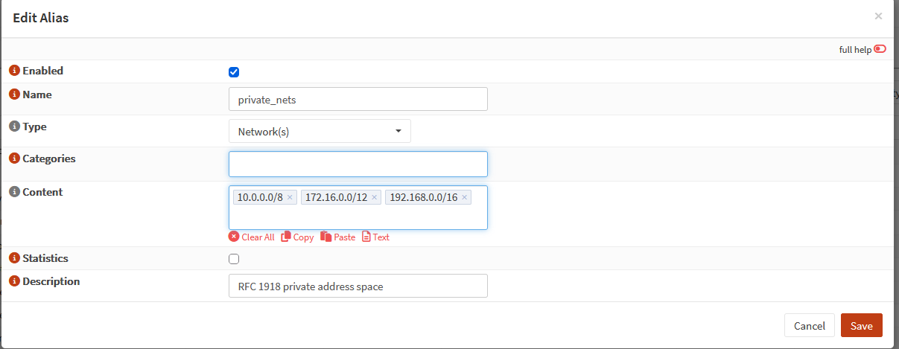
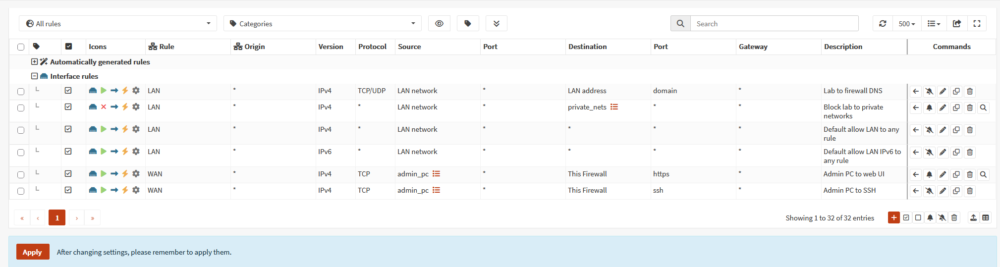
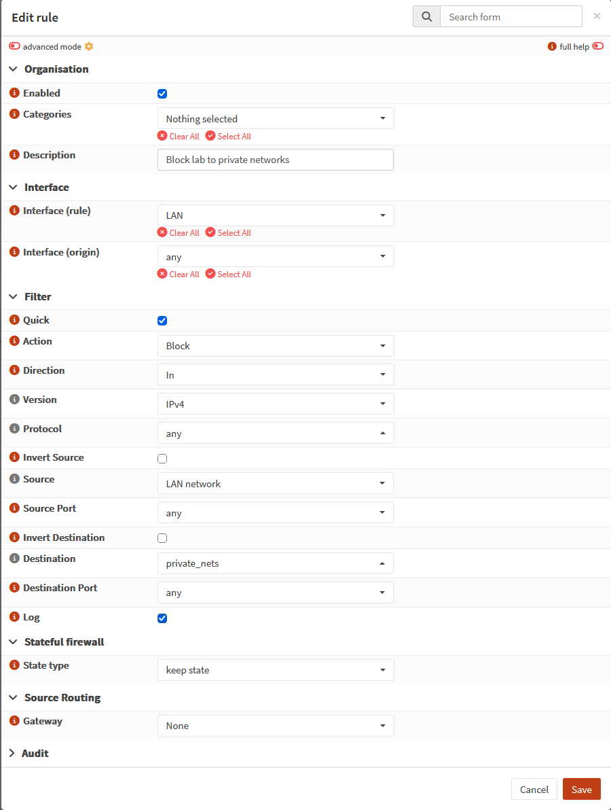

# Firewall Rules

## Aliases

| Alias | Type | Content | Used by |
|---|---|---|---|
| `admin_pc` | Host(s) | `192.168.40.95` | WAN management rules |
| `private_nets` | Network(s) | `10.0.0.0/8`, `172.16.0.0/12`, `192.168.0.0/16` (RFC 1918) | Lab block rule |



## Rules (as configured)



| Interface | Action | Protocol | Source | Destination | Port | Log | Description |
|---|---|---|---|---|---|---|---|
| LAN | Pass | TCP/UDP | LAN net | LAN address | 53 | | Lab to firewall DNS |
| LAN | **Block** | any | LAN net | `private_nets` | any | ✓ | Block lab to private networks |
| LAN | Pass | any | LAN net | any | any | | Default allow LAN to any (internet) |
| WAN | Pass | TCP | `admin_pc` | This Firewall | 443 | ✓ | Admin PC to web UI |
| WAN | Pass | TCP | `admin_pc` | This Firewall | 22 | ✓ | Admin PC to SSH |

All rules use `quick` (first match wins). WAN has no other pass rules, so everything else arriving on the WAN is dropped by the default deny.



### Ordering mistake caught before applying

New rules were appended **below** the default allow-all rule. Applied in that order, lab traffic to the home network would have matched "allow any" first and never reached the block. The DNS and block rules were moved above the allow rule before applying.

### Rules not in effect until applied

After reordering, `pfctl -sr` still showed the old rule set: saving changes the configuration, but only **Apply** loads it into the running firewall. Checking the live rules caught it.

## Running rule set (lab interface)

The configuration is the intent; `pfctl -sr` is what's enforced. Full output: [`../evidence/pf-lan-ruleset-final.txt`](../evidence/pf-lan-ruleset-final.txt).

```
block drop in log on ! vtnet1 inet from 10.10.10.0/24 to any
pass in log quick on vtnet1 inet proto udp from any port = bootpc to 255.255.255.255 port = bootps ...
pass in log quick on vtnet1 proto udp from any port = bootpc to (self) port = bootps ...
pass out log quick on vtnet1 proto udp from (self) port = bootps to any port = bootpc ...
pass in quick on vtnet1 inet proto tcp from (vtnet1:network) to (vtnet1) port = domain ...
pass in quick on vtnet1 inet proto udp from (vtnet1:network) to (vtnet1) port = domain ...
block drop in log quick on vtnet1 inet from (vtnet1:network) to <private_nets> ...
pass in quick on vtnet1 inet from (vtnet1:network) to any flags S/SA keep state ...
```

| Line | Meaning |
|---|---|
| 1 | Automatic anti-spoofing: a lab address arriving on any other interface is dropped |
| 2-4 | Automatic DHCP rules |
| 5-6 | The one GUI DNS rule becomes two pf rules (TCP and UDP) sharing a label |
| 7 | `block drop`: silently discarded, no reply, so a scanner can't tell whether anything is there |
| 8 | Internet access |

### Anti-lockout rule removed

Before the change, the running rule set also contained:

```
pass in log quick on vtnet1 proto tcp from any to (self) port = ssh ...
pass in log quick on vtnet1 proto tcp from any to (self) port = http ...
pass in log quick on vtnet1 proto tcp from any to (self) port = https ...
```

OPNsense's automatic anti-lockout rule, which let **any lab host** reach the firewall's SSH and web UI. `(self)` covers every address the firewall owns, including its WAN address. Since the firewall is managed from the WAN, it was disabled (Firewall → Settings → Advanced), and the web UI's listen interface was restricted to WAN as a second, independent control.
